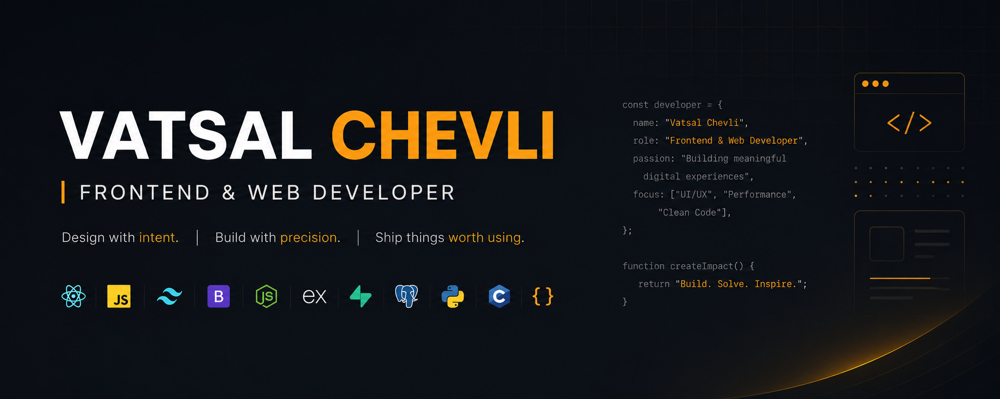

# Vatsal Chevli

  

  
  
  

---

## About

I'm **Vatsal Chevli**, a BCA undergrad and indie builder shipping **Beyond the Devices** end to end — native Android + macOS apps, a custom local protocol, and the site, releases, and polish around them.

My roots are in frontend — React, JavaScript, Tailwind — and that designer-engineer instinct carried into native: **Kotlin + Jetpack Compose**, **Swift + SwiftUI**, with a Next.js front door at [beyondthedevices.com](https://beyondthedevices.com). I obsess over the details that make software feel effortless — clean interfaces, honest UX, reliable state, and privacy by architecture, not by promise.

**Currently:** hardening BTD file transfers and getting the Android app ready for its Google Play launch.

> **Design with intent. Build with precision. Ship things worth using.**

---

## Now building

**Beyond the Devices** — no account, no cloud relay. Your phone and Mac talk directly over your local network.

- **Everyday continuity** — two-way clipboard text, media control, Android notifications with direct reply, URL handoff, and live phone health on the Mac
- **Files that finish** — fast binary transfers with SHA-256 verification and resume across drops and restarts. Currently Mac `1.2.6` · Android `1.2.4`
- **Private by architecture** — pinned TLS, expiring QR pairing codes, explicit Mac approval. Pairing data never leaves your two devices
- **Shipping now** — Mac for Apple Silicon (macOS 14+) · Android on Google Play from **19 November 2026** · [Get it here](https://beyondthedevices.com/download)
- **Next** — file browser with shared-storage + SD-card access, then screen mirroring

---

## Tech Stack

### Current focus — Mobile & Desktop

### Web

### Fundamentals

---

## Featured Projects

| Project | Description | Tech Stack | Links |
|---|---|---|---|
| **Beyond the Devices** | Local-first Android × macOS companion: clipboard, media, notifications, links, and resumable file transfers. No account, no cloud. | Kotlin · Swift · Jetpack Compose · SwiftUI · TLS | [Site](https://beyondthedevices.com) · [Download](https://beyondthedevices.com/download) |
| **Recount** | A storytelling and reflection journal that transforms daily thoughts into meaningful narratives. | React · JavaScript · Tailwind CSS | [Visit](https://recounts.net/) · [Repo](https://github.com/VatsalDC/Recount-Showcase) |
| **Squeeze** | A privacy-first image compressor with precise control over quality, dimensions, and output size. | React · JavaScript · Canvas API | [Visit](https://squeezeit.netlify.app) · [Repo](https://github.com/VatsalDC/squeeze-showcase) |
| **Pixel Playground** | An interactive canvas and creative UI sandbox built for experimenting with visual ideas. | React · JavaScript · Canvas API | [Visit](https://pixelpg.netlify.app) · [Repo](https://github.com/VatsalDC/Pixel-Playground_Showcase) |
| **Kanban Board** | A drag-and-drop task management tool with persistent state and a focused workflow. | React · JavaScript · Local Storage | [Visit](https://yourkanbanboard.netlify.app) · [Repo](https://github.com/VatsalDC/kanbanBoard) |
| **Thaughtify** | A lightweight micro-thoughts and daily reflection tool for capturing ideas in the moment. | React · JavaScript · Tailwind CSS | [Visit](https://thaughtify.netlify.app) · [Repo](https://github.com/VatsalDC/Thaughtify) |

---

## GitHub Activity

  
  

---

## Connect

  
  
  
  
  

  Built with curiosity · ❤️ · shipped from India🇮🇳

